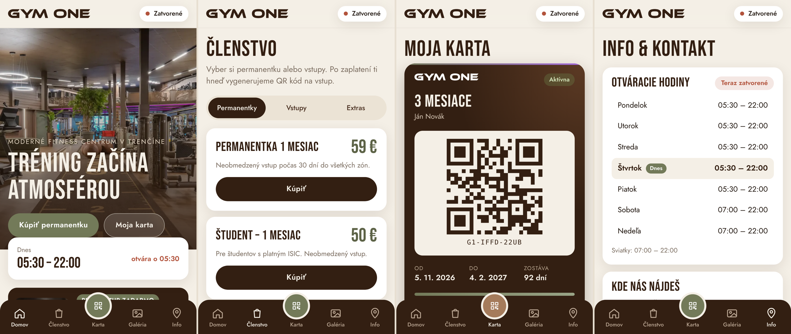

# GYM ONE Trenčín – mobilná aplikácia

Webová aplikácia (PWA) pre fitness centrum **GYM ONE**, Gen. M. R. Štefánika 6833, Trenčín.
Dá sa otvoriť v mobile a pridať na plochu („Pridať na plochu“) – potom sa správa ako natívna appka a funguje aj offline.



## Čo appka obsahuje
- **Domov** – úvodná fotka interiéru, stav „Otvorené/Zatvorené“ podľa času v Trenčíne, promo prvý vstup zadarmo, zóny fitka.
- **Členstvo** – nákup permanentiek (1 / 3 / 12 mesiacov, študent, senior), balíkov 10 a 20 vstupov, jednorazových vstupov a MultiSport/UpBalansea.
  Pokladňa s overením údajov a karty (demo platobná brána).
- **Moja karta** – zakúpené permanentky s QR kódom na vstup, platnosť, zostávajúce dni/vstupy, história.
- **Galéria** – 23 fotiek interiéru s filtrom podľa zón a prehliadačom (swipe).
- **Info** – otváracie hodiny (zvýraznený dnešok, slovenské sviatky), presná poloha na mape (48.894554, 18.062685), navigácia cez Google Maps / Waze / Apple Mapy, kontakt.

## Dizajn
Farby a písma prevzaté z gymone.sk a interiéru: olivová `#737A59`, tmavé drevo `#331F12`, orech `#A57B5B`, krémová `#F4EFE6`,
fialový akcent podľa LED pásov. Písma Bebas Neue + Jost.

## Spustenie
```bash
python3 -m http.server 8000
# otvor http://localhost:8000
```
Na zverejnenie stačí nahrať priečinok na ľubovoľný statický hosting (GitHub Pages, Netlify…).

## Čo treba doplniť pre ostrú prevádzku
- **Platby** – napojiť reálnu bránu (napr. Stripe, GP webpay, Besteron); teraz je platba simulovaná.
- **Backend** – permanentky sa ukladajú len v telefóne (localStorage). Pre overovanie QR na recepcii je potrebný server/rezervačný systém.
- **Fotky a logo** pochádzajú z webu gymone.sk – pred zverejnením treba súhlas prevádzkovateľa.
